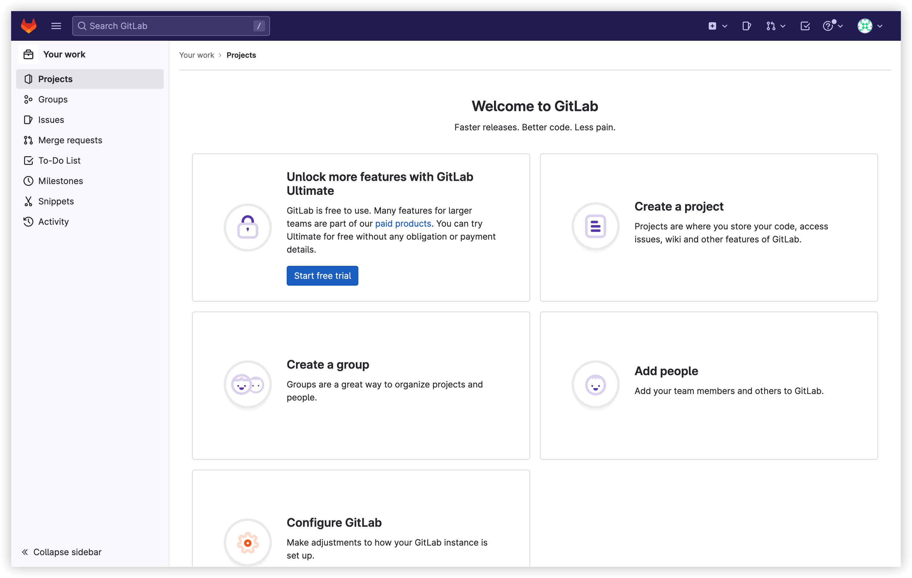

> 예전에 [velog](https://velog.io/@devmingeon/AWS-Linux2%EC%97%90-zsh-gitlab-ee-%EC%84%9C%EB%B2%84-%EA%B5%AC%EC%B6%95%ED%95%98%EA%B8%B0)에 올렸던 글을 옮겨 왔습니다.

## zsh 설정

### zsh installation
```
sudo yum install zsh
```
### git installation
```
sudo yum install git
```
oh my zsh를 설치하기 위해서는 git이 필요합니다.

### oh-my-zsh
```
sh -c "$(curl -fsSL https://raw.githubusercontent.com/ohmyzsh/ohmyzsh/master/tools/install.sh)"
```
### zsh로 쉘 변경
```
sudo chsh -s /bin/zsh ec2-user

#나갔다가 들어온 후 확인
echo $SHELL
```

### chsh not found 해결
```
sudo yum install util-linux-user
```


### plugin: zsh-syntax-highlighting
```
git clone https://github.com/zsh-users/zsh-syntax-highlighting.git ${ZSH_CUSTOM:-~/.oh-my-zsh/custom}/plugins/zsh-syntax-highlighting
```
### plugin: zsh-autosuggestions
```
git clone https://github.com/zsh-users/zsh-autosuggestions ${ZSH_CUSTOM:-~/.oh-my-zsh/custom}/plugins/zsh-autosuggestions
```
### plugin: 적용
```
plugins=(
  git
  zsh-syntax-highlighting
  zsh-autosuggestions
)
```

## AWS Linux2 관련 설치

```
sudo yum install -y curl policycoreutils-python openssh-server openssh-clients perl
```
```
sudo systemctl enable sshd
```
```
sudo systemctl start sshd
```
```
sudo firewall-cmd --permanent --add-service=http
```
```
sudo firewall-cmd --permanent --add-service=https
```
```
sudo systemctl reload firewalld
```
### firewall not found 해결
```
yum install firewalld
```
```
systemctl unmask firewalld
```
```
systemctl enable firewalld
```
```
systemctl start firewalld
```

## gitlab-ee 설치

### gitlab-ee 설치를 위한 저장소 등록

```
curl https://packages.gitlab.com/install/repositories/gitlab/gitlab-ee/script.rpm.sh | sudo zsh
```
### external_url을 설정하면서 설치
```
sudo EXTERNAL_URL="https://gitlab.example.com" yum install -y gitlab-ee
```
https://gitlab.example.com 부분에 aws public ipv4 dns를 넣고, 원하는 포트 주소를 작성하세요.
형태 : **aws-public-ipv4-dns:port**

그 후 aws에서 0.0.0.0/과 ::/0을 여시면 됩니다. 만약 정해진 ip가 있으시면 거기로 설정하시면됩니다.


### 첫 로그인 
첫 로그인은 아래와 같은 순서로 합니다.
주소 : http://aws-public-ipv4-dns/users/sign_in
계정 : root
암호는 아래와 같이 구합니다.

```
sudo cat /etc/gitlab/initial_root_password | grep Password
```




Password : 뒤에 나오는 긴 문자가 비밀번호입니다.


로그인 후 EditProfile - Password로 가서 비밀번호를 꼭 변경하십시오.
