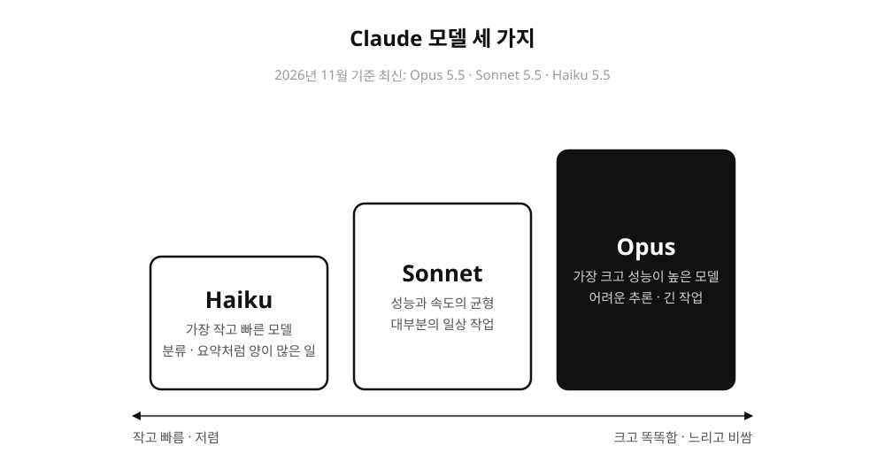
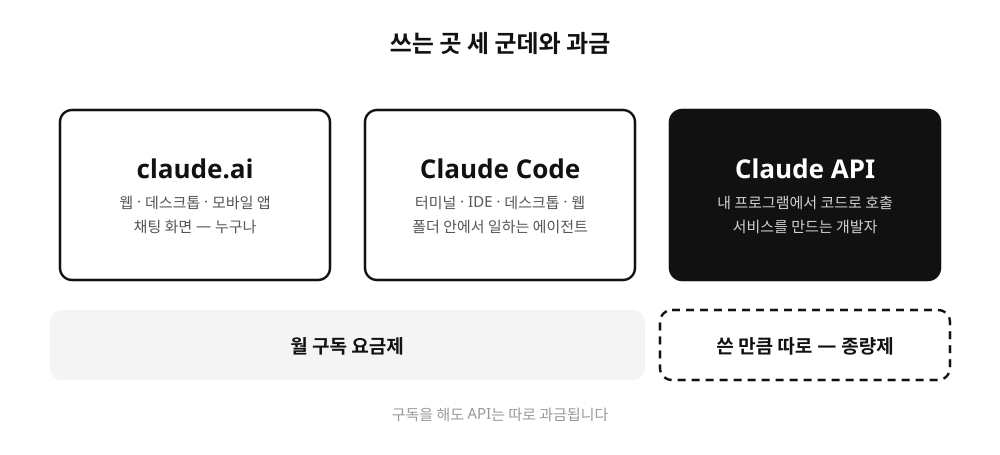
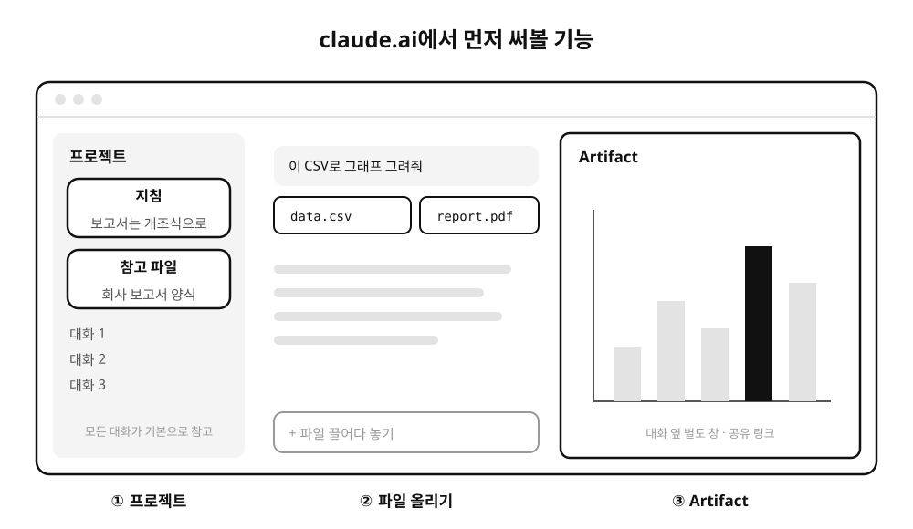

올해 Claude를 소개하는 강의를 몇 번 했습니다. 현대자동차·현대모비스 제조솔루션본부 임직원분들 앞에서 VE(버추얼 엔지니어링)에 AI를 붙이는 강의를 했고, 5월 17일에는 컴퓨터구조 II 수업에 게스트로 들어가 학생들에게 AI로 공부하는 법을 이야기했어요. 청중은 많이 달랐는데 앞부분에서 설명하는 내용은 거의 같더라고요. Claude가 뭔지, 어디서 쓰는지, 어떤 기능부터 써보면 되는지요.

그래서 그 공통 부분을 세 편으로 나눠 정리해 두려고 합니다. 이번 글은 처음 써보는 분 기준의 기초이고, 2편은 Claude Code, 3편은 맥락을 주고 기능을 확장하는 방법을 다룹니다.

## Claude는 무엇인가요

Claude는 Anthropic이라는 회사가 만든 LLM(대규모 언어 모델)입니다. ChatGPT를 만든 곳이 OpenAI이고 Gemini를 만든 곳이 Google인 것처럼, Claude는 Anthropic의 모델이에요. 질문을 하면 답을 하고 글을 쓰고 코드를 짜는, 다들 한 번쯤 써보신 그 종류의 AI입니다.

학생들 앞에서는 "요즘 코딩할 때 ChatGPT 안 쓰는 사람 있나요?"라고 먼저 물어봤습니다. 쓰느냐 안 쓰느냐는 이미 정해진 이야기라서, 이 글도 어떻게 쓰는지에 집중하려고 합니다.

## 모델 이름

Claude는 크기가 다른 모델 여러 개를 묶어 부르는 이름입니다. 이름이 시처럼 붙어 있어요.

이름 뒤에는 세대 번호가 붙습니다. 이 글을 쓰는 2026년 11월에는 Opus 5.5, Sonnet 5.5, Haiku 5.5가 최신이에요. 번호는 계속 바뀌니까 외울 필요는 없고, 큰 모델일수록 똑똑하지만 느리고 비싸다는 감만 가지고 계시면 됩니다. 처음에는 기본값으로 두고 쓰다가 결과가 아쉬울 때 더 큰 모델로 바꿔보는 정도면 충분해요.

## 쓰는 곳 세 군데

같은 Claude라도 어디서 쓰느냐에 따라 할 수 있는 일이 꽤 다릅니다. 강의에서는 이렇게 세 군데로 나눠 설명했습니다.

claude.ai는 우리가 흔히 떠올리는 채팅 화면입니다. 브라우저에서 쓰는 웹 버전이 있고 데스크톱 앱과 모바일 앱도 있어요. 대화 기록은 계정에 묶여 있어서 어디서 열어도 이어집니다.

Claude Code는 내 컴퓨터의 폴더 안에서 일하는 도구입니다. 파일을 읽고 고치고 명령을 실행해요. 2편에서 자세히 다룹니다.

API는 개발자가 자기 프로그램 안에서 Claude를 부를 때 씁니다. 하나 주의할 점은 과금 방식이 다르다는 거예요. claude.ai와 Claude Code는 월 구독 요금제로 쓸 수 있지만, API는 쓴 만큼 따로 돈이 나가는 종량제입니다. 구독을 하고 있다고 API가 공짜가 되지는 않아서, 강의에서도 이 부분은 꼭 짚고 넘어갔습니다.

## claude.ai에서 먼저 써볼 기능

비개발 직무라면 claude.ai만 잘 써도 충분합니다. 현대자동차 강의에서도 "비개발 직무는 오늘 이거면 충분합니다"라고 말씀드렸어요. 처음에 익혀두면 좋은 기능은 이 정도입니다.

### 파일 올리기

PDF, 엑셀이나 CSV, 이미지 같은 파일을 대화창에 끌어다 놓으면 Claude가 내용을 읽고 답합니다. 보고서 PDF를 올리고 요약을 부탁하거나, CSV를 올리고 그래프를 그려달라고 하는 식이에요. 강의 시연에서는 브래킷 설계 데이터 CSV를 올리고 대화만으로 분석부터 보고서까지 이어가는 걸 보여드렸습니다. 설치도 코딩도 없이요.

### 프로젝트

프로젝트는 관련 대화를 한 폴더에 모아두는 기능입니다. 프로젝트마다 지침과 참고 파일을 넣어둘 수 있는데, 여기 넣은 내용은 그 프로젝트 안의 모든 대화가 기본으로 참고해요. 예를 들어 "보고서는 항상 개조식으로 써줘"라는 지침과 회사 보고서 양식 파일을 넣어두면, 매번 대화를 시작할 때마다 같은 설명을 붙여넣지 않아도 됩니다.

같은 설명을 반복하지 않게 해준다는 점에서 3편에서 다룰 CLAUDE.md와 같은 발상입니다.

### Artifact

Claude에게 문서나 코드, 간단한 웹페이지를 만들어달라고 하면 대화 옆에 별도 창으로 결과물이 뜹니다. 이걸 Artifact라고 부릅니다. 대화 중간에 섞이지 않고 따로 보이니까 수정을 부탁하면 그 창의 내용이 바뀌고, 완성되면 복사하거나 공유 링크로 보낼 수 있어요. 차트나 계산기 같은 작은 도구를 만들 때 특히 편합니다.

## 쓸 때 조심할 것

Claude는 모르는 것도 그럴듯하게 지어낼 수 있습니다. 이걸 환각(hallucination)이라고 부르는데, 숫자나 출처, 고유명사에서 특히 자주 나와요. 중요한 내용은 원래 자료와 한 번 맞춰보는 습관이 필요합니다.

학생 강의에서는 반대 방향의 위험도 이야기했습니다. Claude가 설명을 워낙 잘해서, 읽는 순간 이해했다고 착각하기 쉽다는 거예요. 그때 Andrej Karpathy의 말을 인용했는데요. "You can outsource your thinking, but you cannot outsource your understanding." 설명은 맡겨도 되지만 그 설명을 내 것으로 만드는 일은 직접 해야 한다는 뜻으로 소개했습니다.

회사 자료를 올릴 때는 보안 정책도 먼저 확인해 주세요. 회사마다 외부 AI에 올려도 되는 자료의 기준이 다릅니다.

다음 편에서는 Claude Code를 다룹니다. 대화창에서 답을 받는 것과 Claude가 직접 파일을 만지며 일하는 것이 어떻게 다른지 이야기해 보겠습니다.
