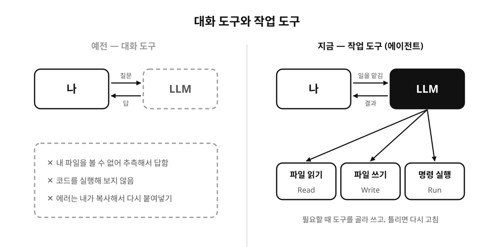
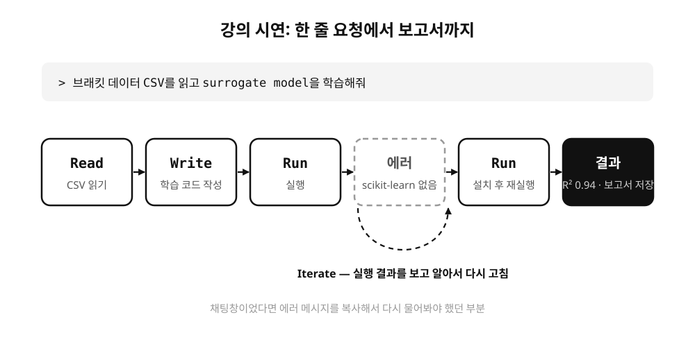
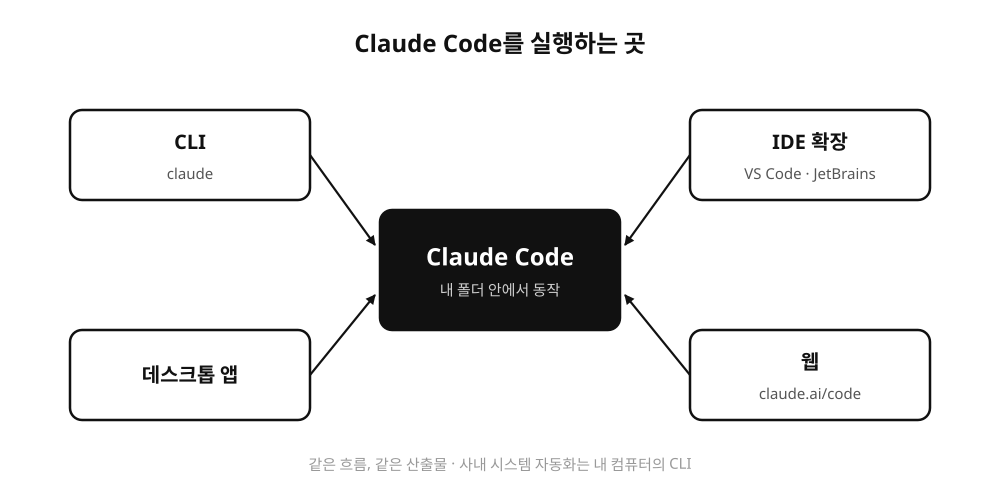
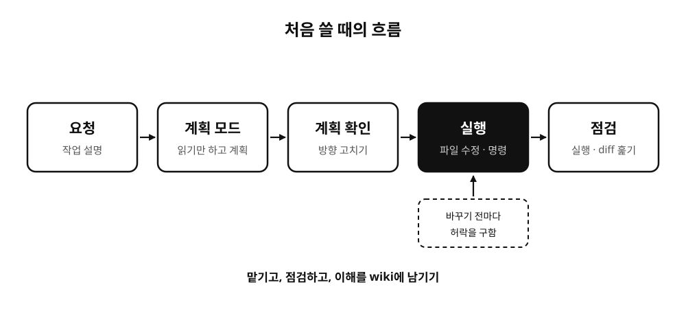

[1편](/posts/claude-basics-1-intro/)에서는 claude.ai 채팅 화면을 중심으로 Claude를 소개했습니다. 이번 편은 Claude Code입니다. 현대자동차 강의에서 시연한 것도 이 도구였고, 제가 매일 가장 많이 쓰는 것도 이쪽이에요.

## 대화 도구와 작업 도구

강의에서 이 부분을 시작할 때 "LLM에 대한 인식을 한번 업데이트하셔야 합니다"라고 말씀드렸습니다. 예전의 LLM은 질문을 넣으면 답을 돌려주는 대화 도구였어요. 이 방식은 한계가 분명합니다. 내 파일을 직접 볼 수 없으니 내용을 추측해서 답하고, 코드를 써줘도 실행해 보지 않으니 돌아가는지 모릅니다. 에러가 나면 제가 복사해서 다시 붙여넣어야 했고요.

요즘의 LLM은 도구를 쓸 수 있습니다. 파일을 읽는 도구, 파일을 쓰는 도구, 명령을 실행하는 도구를 쥐여주면 모델이 필요할 때 그 도구를 골라 씁니다. 파일을 직접 읽고, 코드를 만들고, 실행해서 결과를 확인하고, 틀리면 다시 고쳐요. 사람이 일하는 방식과 거의 같습니다. 이렇게 도구를 쓰면서 스스로 여러 단계를 이어가는 LLM을 에이전트라고 부릅니다.



학생 강의에서는 이걸 "Claude Code는 챗봇이 아니라 일종의 작업자에 가깝다"고 소개했어요.

## Claude Code가 하는 일

Claude Code는 내 컴퓨터의 프로젝트 폴더 안에서 일하는 에이전트입니다. 강의 슬라이드에서는 할 수 있는 일을 네 단어로 정리했습니다.



마지막 Iterate가 제일 중요합니다. 시연 화면에서는 "브래킷 데이터 CSV를 읽고 surrogate model을 학습해줘"라고 한 줄 입력했어요. Claude Code가 CSV를 읽고 학습 코드를 쓰고 실행했는데, 중간에 scikit-learn이 설치되어 있지 않다는 에러가 났습니다. 그러자 알아서 설치하고 다시 실행해서 R² 0.94라는 결과를 내고, 보고서 파일까지 저장했습니다. 채팅창이었다면 에러 메시지를 제가 복사해서 다시 물어봐야 했을 부분이에요.

## 어디서 실행하나요

Claude Code라고 하면 터미널 화면부터 떠올리시는데, 지금은 실행할 수 있는 곳이 여러 군데입니다.



강의에서는 터미널 화면을 보여드린 다음, 개발자가 아니신 분들을 위해 같은 데모를 웹에서 돌린 화면도 보여드렸습니다. 같은 흐름에 같은 산출물이 나왔고, 차이는 질문을 얼마나 구체적으로 하느냐 정도였어요. 다만 회사 파일이나 사내 시스템과 직접 연결해서 자동화하려면 결국 내 컴퓨터에서 도는 CLI 쪽이 필요해서, 이건 IT·개발팀과 함께 쓰는 방식이라고 설명드렸습니다.

## 처음 써볼 때

설치를 마쳤다면 작업할 폴더로 이동해서 `claude`를 실행합니다.

```bash
cd my-project
claude
```

그다음은 채팅처럼 하고 싶은 일을 한국어로 적으면 됩니다. "이 폴더 구조 설명해줘"처럼 읽기만 하는 요청부터 시작해 보시길 권해요. 파일을 고치거나 명령을 실행해야 하는 순간이 오면 Claude Code가 먼저 허락을 구합니다. 어떤 파일을 어떻게 바꿀지, 어떤 명령을 실행할지 보여주고 승인을 받은 다음에 진행해요. 처음에는 이 확인 창을 하나하나 읽어보면서 Claude가 무슨 일을 하려는지 따라가 보시는 게 좋습니다. 익숙해지면 특정 명령은 매번 묻지 않도록 허용해 둘 수 있습니다.

작업이 크면 바로 시키기보다 계획부터 세우게 하는 게 편합니다. 계획 모드에서는 Claude가 파일을 고치지 않고 읽기만 하면서 어떻게 할지 먼저 정리해서 보여줘요. 계획을 보고 방향을 고친 뒤에 실행시키면 엉뚱한 곳을 건드리는 일이 줄어듭니다.



## 맡기고, 점검하기

학생 강의에서 이런 도구를 다룰 때 필요한 태도로 "맡기고, 점검하고, 이해를 wiki에 남기기"를 이야기했습니다. Claude Code는 일을 정말 많이 해주는데, 그만큼 확인 없이 넘어가기도 쉬워요. 결과가 그럴듯해 보여도 실제로 실행해 보고, 고친 파일은 diff로 한 번씩 훑어보는 게 좋습니다. 현대자동차 강의에서도 surrogate model의 예측이 빨라도 신뢰성 검증이 먼저라고 한참 이야기했는데, Claude Code가 만든 결과물에도 같은 이야기가 적용되는 것 같아요.

그리고 하나 더. Claude Code는 세션이 끝나면 그 대화에서 알려준 것을 기억하지 못합니다. 새 세션을 열 때마다 "이 프로젝트는 pnpm 써", "답은 한국어로 해" 같은 설명을 반복하게 되는데요. 이걸 해결하는 방법이 3편에서 다룰 CLAUDE.md입니다.
