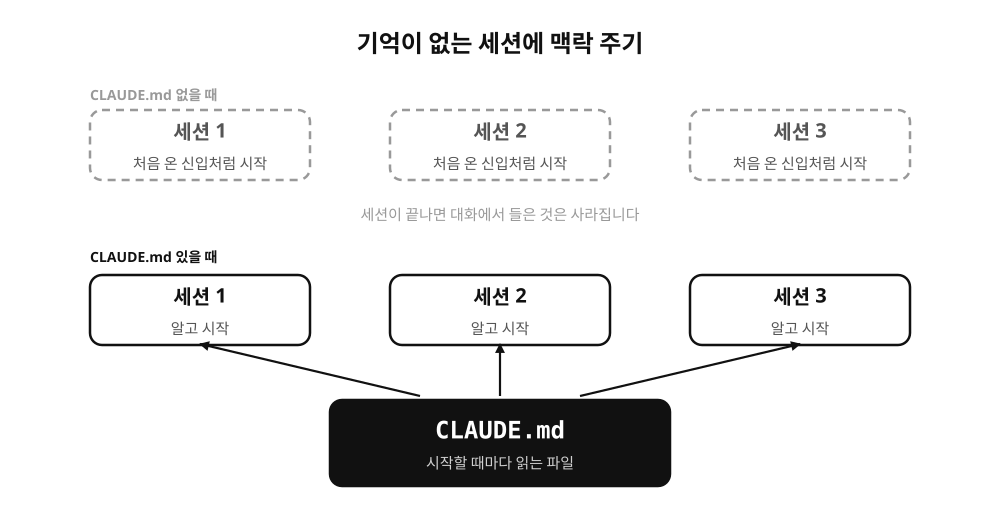
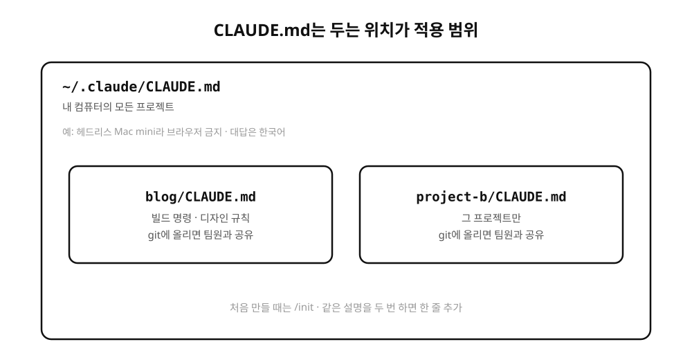
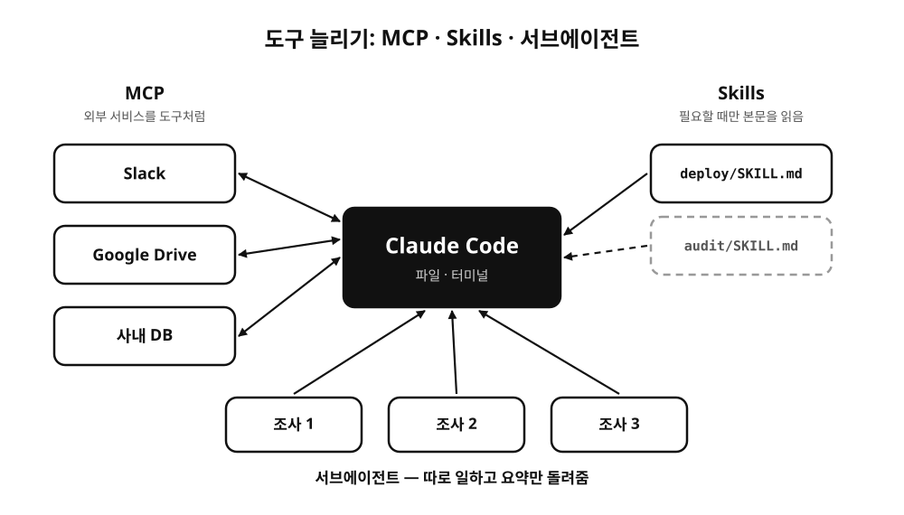

[2편](/posts/claude-basics-2-code/)에서 Claude Code가 파일을 읽고 고치고 실행하는 걸 봤습니다. 이번 편은 그다음 단계예요. Claude에게 우리 일의 맥락을 어떻게 알려주는지, 그리고 Claude가 쓸 수 있는 도구를 어떻게 늘리는지를 다룹니다.

## Claude는 기억이 없습니다

LLM은 대화가 끝나면 그 대화에서 들은 것을 기억하지 못합니다. 학생 강의에서 "ChatGPT가 어제 해준 설명, 오늘도 기억나세요?"라고 물어봤는데, 사실 이건 Claude 쪽도 마찬가지예요. 새 세션은 매번 처음 온 신입과 같습니다.

현대자동차 강의에서는 이걸 "Agent를 제대로 쓰려면 맥락을 줘야 한다"고 설명했습니다. 매번 프롬프트로 처음부터 설명하면 업무 기준이 사람 머릿속에만 있고, 대화가 끝나면 다 사라지니까요.



## CLAUDE.md

Claude Code는 시작할 때 CLAUDE.md라는 파일을 찾아서 읽습니다. 여기 적어둔 내용은 세션마다 다시 말하지 않아도 Claude가 알고 시작해요. 1편에서 소개한 claude.ai 프로젝트의 지침과 같은 역할입니다.

두는 위치에 따라 적용 범위가 달라집니다.



제 홈 디렉토리 CLAUDE.md에는 이 컴퓨터에 대한 설명이 들어 있습니다. 원격으로 쓰는 헤드리스 Mac mini라서 브라우저를 띄우면 안 된다는 것, 대답은 한국어로 하라는 것 같은 내용이에요. 이 블로그 폴더의 CLAUDE.md에는 빌드 명령과 디자인 규칙을 적어뒀습니다.

```markdown
# Blog

Astro 5 static blog. Push to `main` deploys to GitHub Pages.

## Commands

- `pnpm -s astro check`: must report `0 errors` before any commit.
- `pnpm -s build`: the source of truth when dev looks wrong.
```

처음 만들 때는 프로젝트 폴더에서 Claude Code를 열고 `/init`을 입력하면 됩니다. Claude가 폴더를 훑어보고 초안을 써줘요. 그다음부터는 같은 설명을 두 번 하게 될 때마다 한 줄씩 추가하는 정도로 키워가면 됩니다. 너무 길어지면 매 세션 읽는 양이 늘어나니까, 정말 매번 필요한 것만 남기는 게 좋더라고요.

현대자동차 강의에서는 여기서 한 걸음 더 나가 LLM Wiki를 소개했습니다. 변수 정의, 해석 조건, 검증 기준, 보고서 양식, 그리고 반복됐던 실패 사례까지 LLM이 읽을 수 있는 문서로 쌓아두는 방식이에요. 실패 사례가 특히 값지다고 말씀드렸는데, 같은 오류를 또 안 겪게 해주기 때문입니다. 제가 실제로 굴리는 구조는 [LLM 위키 글](/posts/llm-wiki/)에 따로 정리해 두었습니다.

## MCP

Claude Code가 기본으로 다룰 수 있는 건 내 컴퓨터의 파일과 터미널입니다. 그런데 일을 하다 보면 Slack 메시지나 Google Drive 문서, 사내 데이터베이스처럼 바깥에 있는 것도 봐야 할 때가 있어요.

MCP(Model Context Protocol)는 이런 외부 서비스를 Claude에 연결하는 표준입니다. Anthropic이 2024년 11월에 공개했고 지금은 다른 AI 도구들도 같은 방식을 지원해요. 서비스마다 MCP 서버를 하나씩 붙이면, Claude가 그 서비스를 도구처럼 꺼내 씁니다. USB 포트에 장치를 꽂는 것과 비슷하다고 설명하면 대부분 바로 이해하시더라고요. claude.ai에서는 커넥터라는 이름으로 같은 기능을 설정 화면에서 켤 수 있습니다.



## Skills

Skill은 특정 작업을 하는 방법을 적은 문서 묶음입니다. 폴더 하나에 `SKILL.md`라는 지침 파일을 두고, 필요하면 스크립트나 참고 자료를 같이 넣어요. Claude는 평소에는 각 Skill의 짧은 설명만 알고 있다가, 지금 하는 일에 맞는 Skill이 있으면 그때 본문을 읽어서 따릅니다.

CLAUDE.md와 비슷해 보이지만 쓰임이 다릅니다. CLAUDE.md는 매 세션 항상 읽히는 기본 규칙이고, Skill은 필요할 때만 꺼내 보는 작업 매뉴얼이에요. 저는 이 블로그 배포 절차를 Skill로 만들어 뒀습니다. 버전 올리기, 빌드, 푸시, 배포 확인까지 순서가 정해져 있는 일이라 매번 설명하는 것보다 Skill로 두는 게 편했어요.

## 서브에이전트

일이 커지면 Claude Code가 다른 Claude를 불러서 일을 나눠 맡길 수 있습니다. 이걸 서브에이전트라고 해요. 서브에이전트는 자기만의 대화 공간에서 일하고, 끝나면 결과 요약만 돌려줍니다. 수십 개 파일을 뒤지는 조사 작업을 맡기면 원래 대화에는 결론만 남아서 대화가 덜 어지러워져요. 여러 개를 동시에 돌릴 수도 있습니다.

## 정리하며

세 편에 걸쳐 강의에서 앞부분에 하던 이야기를 옮겨 봤습니다. 처음 쓰시는 분이라면 claude.ai에서 파일 올리기와 프로젝트부터 써보시고, 반복 작업이 보이기 시작하면 Claude Code와 CLAUDE.md로 넘어가시는 순서를 추천드려요. MCP나 Skills는 같은 일을 몇 번 반복하다 보면 자연스럽게 필요해지는 시점이 옵니다.

강의 자료를 정리하면서 쓴 글이라 빠진 부분이 있을 수 있습니다. 틀린 부분 있으면 알려주세요!
