> 예전에 [velog](https://velog.io/@devmingeon/m1-Pro-%EB%A7%A5%EC%97%90%EC%84%9C-React-Native-%EA%B0%9C%EB%B0%9C-%ED%99%98%EA%B2%BD-%EA%B5%AC%EC%84%B1%ED%95%98%EA%B8%B0)에 올렸던 글을 옮겨 왔습니다.

> 해당 글은 TypeScript Template로 구성하였습니다.

## 목차
1. 서론
2. Homebrew
	1. Node.js
	2. Yarn
	3. Watchman
	4. React Native CLI
	5. CoCoapods
	6. JDK
3. Xcode
	1. xcodebuild 구성법
	2. IOS 애뮬레이터 생성법
4. Android Studio
	1. abs 구성
5. 실행 및 팁
	1. react-native 프로젝트 생성 및 확인
6. 삽질 일대기로 깨달은 것
	1. Yarn Berry 적용 실패와 그 원인 유추
	2. CoCoApods를 gem으로 설치 했을 시 삭제 법
	3. rbenv를 통한 ruby 버그 제거
	4. Multiple Podfiles were found 이 발생하는 이유
7. 결론


## 서론

설치 위주로 정리해뒀습니다 :)

## Homebrew

해당 내용은 m1 pro mac을 기준으로 작성된 만큼, 대부분의 개발구성을 homebrew로 진행합니다!

매우 편하고 좋으니 꼭 사용해보시고, Homebrew 설치법은 추후 다루도록 하겠습니다.

### Node.js 

아시다시피 RN은 React기반으로, node 가 꼭필요합니다.

다행히 맥에서 node 설치는 매우 편리합니다!

##### Install
```bash
brew install node
```

##### Check
```bash
# node 버전 확인
node -–version
# [output] v12.6.0

# npm (node package manager) 버전 확인
npm --version
# [output] 6.9.0
```

### Yarn 

npm은 매우 느립니다. 또 패키지 관리가 직관적이지 않아요! 따라서 yarn 패키지 관리자를 도입합니다.

JavaScript에는 다양한 package 관리자가 있고, 실제로 yarn berry나 pmp같은 관리자는 매우 빠르지만, 현재로써 RN에서 선택할 수 있는 최선의 선택지는 yarn이라고 생각합니다.

yarn berry는 아직 시기상조이고, pmp도 아직 관련 적용 사례가 적어 사용하기 어렵습니다!

##### Install
```bash
brew install yarn
```

##### Check
```bash
yarn --version
# [output] 1.22.19
```

### Watchman

React Native가 타 개발환경과 차별되는 점은 저장하는순간 바로 변경사항을 감지하여 빌드한다는 점입니다.
이 장점으로 인해 RN의 개발속도는 상당히 빠른 축에 속합니다.
Watchman은 해당 역활을 수행해주는 모듈입니다.

##### Install
```bash
brew install watchman
```

##### Check
```bash
watchman –version
```

### React Native CLI
(23.05.12) 최근 React-Native-cli를 global로 설치하면 init에서 버그가 발생하네요. 스킵하고 npx로 진행하는걸 추천드립니다.

### CoCoPods

RN의 장점은 크로스 플랫폼이죠. 당연히 IOS 개발도 진행이 되어야하고, 이런 경우 IOS를 swift가 아닌 다른 패키지로 컨트롤하기위해서는 cocopods가 필요합니다!

##### install
```bash
brew install cocoapods
```

##### Check
```bash
pod --version
```

### JDK

(23.05.12) zulu로 수정합니다.
(24.03.25) java 17 추가합니다.

Android를 돌리기 위해서도 JDK가 필요하죠.
berw를 이용해서 zulu java를 설치합니다. 해당 내용은 React Native 공식문서에 따릅니다.

##### Install
```bash
brew tap homebrew/cask-versions

brew install --cask zulu11
brew install --cask zulu17
```

아래와 같이 나온다면, 그 중 선택하여 설치하면됩니다.

java_home을 추가하지 않으면 아래의 에러가 발생합니다.
<code>gradlew.bat app:installDebug -PreactNativeDevServerPort=8081</code>

JAVA_HOME 추가
zshrc의 가장 아래에 추가하시는걸 추천드립니다.

```zsh
#exports - jdk
export JAVA_HOME="/Library/Java/JavaVirtualMachines/zulu-11.jdk/Contents/Home"
export PATH=${PATH}:$JAVA_HOME/bin
```

##### Check
```bash
java -version && javac --version

# output
# openjdk version "11.0.11" 2021-04-20
# OpenJDK Runtime Environment AdoptOpenJDK-11.0.11+9 (build 11.0.11+9)
# OpenJDK 64-Bit Server VM AdoptOpenJDK-11.0.11+9 (build 11.0.11+9, mixed mode)
# javac 11.0.11
```


## Xcode

당연히 IOS 개발을 위해서는 Xcode 설치가 필요합니다.
저는 cmmand line으로 설치하는 것을 선호하지만.. xcode는 이 방식이 정석입니다. 🥲

##### Install
> 설치 URL
> [https://apps.apple.com/us/app/xcode/id497799835?mt=12](https://apps.apple.com/us/app/xcode/id497799835?mt=12)

##### Check
```bash
# Xcode를 킨 후
command + , #아래의 창을 여는 커맨드입니다.

Command Line Tools가 설정되어있는지 확인해주세요!
```
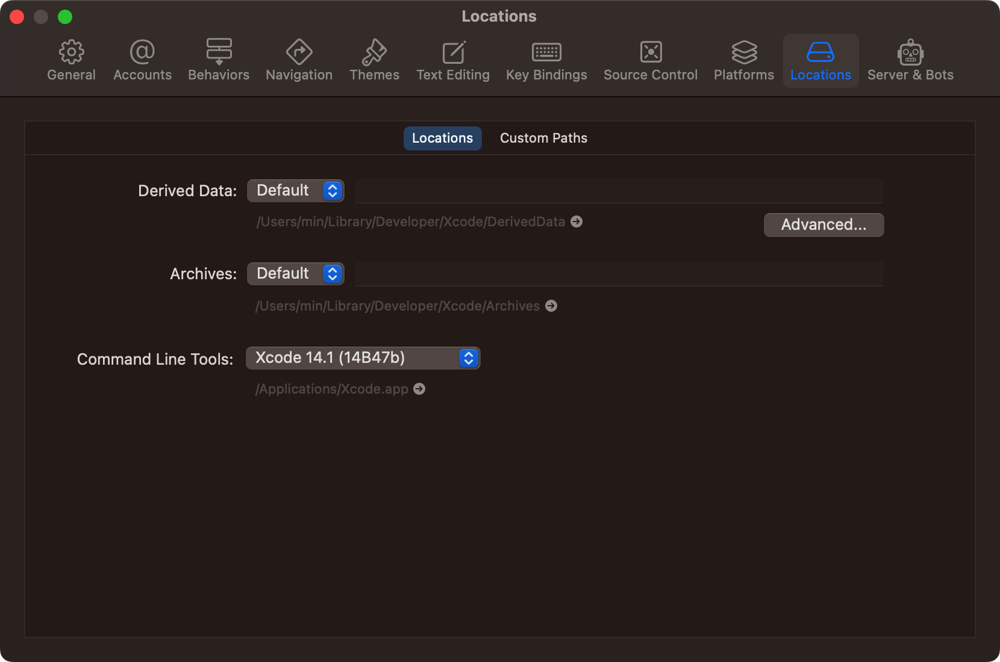


## Android Studio

Android 디버깅을 위해서는 Android Studio가 필요하겠죠?
안드로이드도.. command line 설치가 힘들어요..🥲

##### Install
> 설치 URL 
> [https://developer.android.com/studio](https://developer.android.com/studio)
> 아래의 과정을 따르면됩니다.

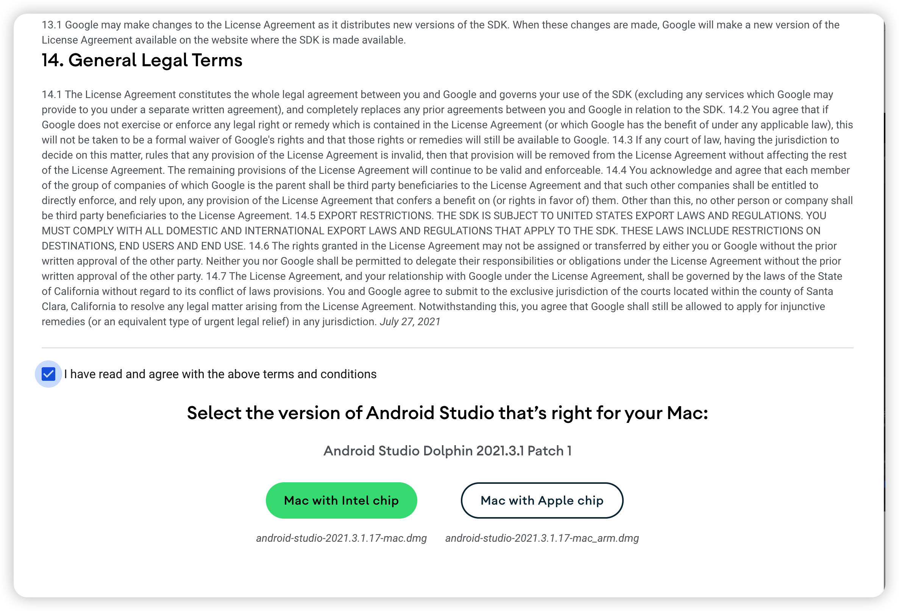
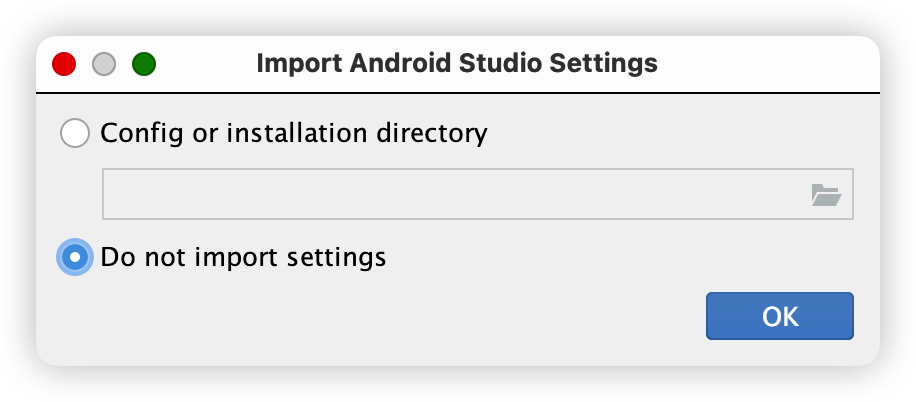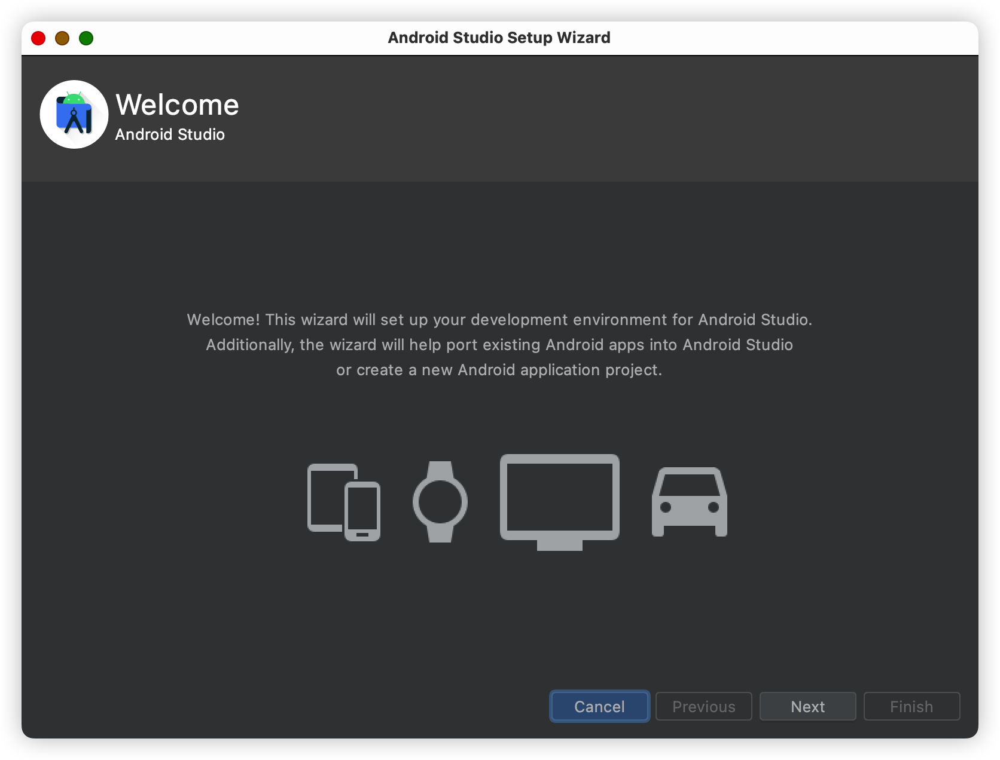
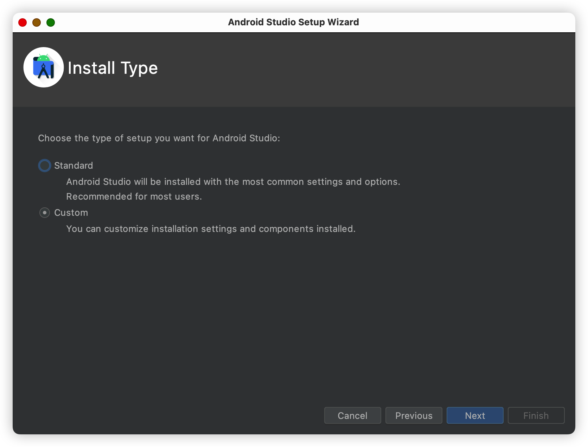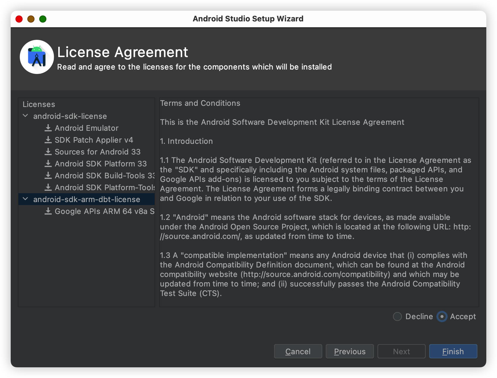
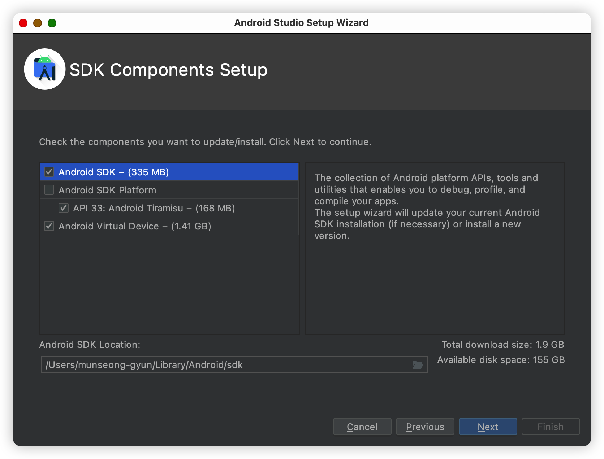
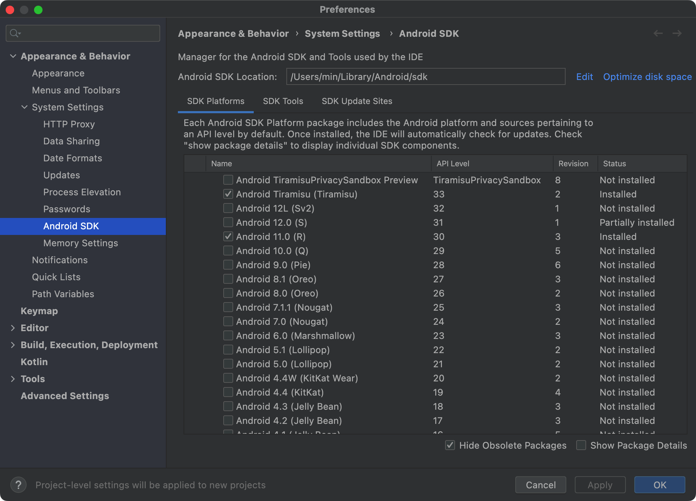
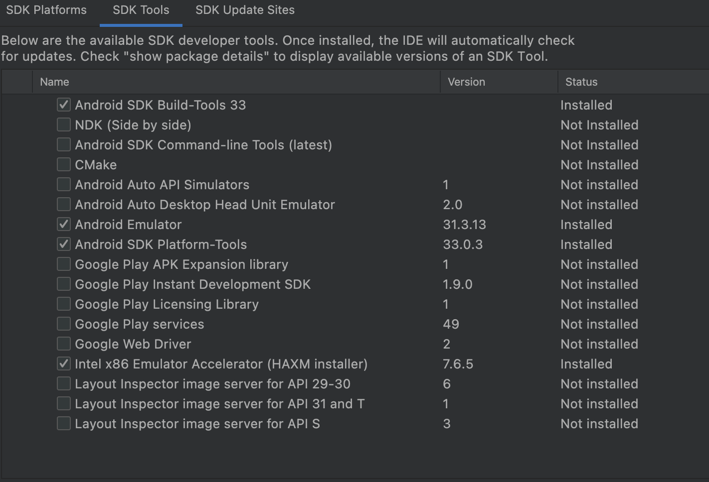

> Android SDK Build-Tools를 고르셔야되는데, 저는 33으로했는데, 필요한 것이 있으시면 아래에 있는 
> <code>show Package Details</code> 를 누르시고 원하시는 걸 선택하시면됩니다.
> 
> 외에는 위와 같이 선택하시고 설치하면됩니다.


(23.05.12)
Android 위치를 추가해주어야합니다.
zshrc에 추가하십시오.
```zsh
#exports
export ANDROID_HOME=$HOME/Library/Android/sdk
export PATH=$PATH:$ANDROID_HOME/emulator
export PATH=$PATH:$ANDROID_HOME/platform-tools
```

<br/>

## 실행 및 팁

### react-native 프로젝트 생성 및 확인

##### Install
```bash
# typescript template 설치
# 원하시는 위치로 이동해서 실행해주세요!
# Sample 내용은 이름 부분이라 변경해주시면됩니다!
# React Native에서 공식적으로 제공하는 가이드라인에서는 Npx로 접근하라 명시되어있습니다.
# 반드시 글로벌 버전의 cli를 제거하고 실행해야합니다.
npx react-native init Sample --template react-native-template-typescript

# javascript 버전
npx react-native init Sample
```

##### Check
```bash
cd Sample

yarn start # start watchman
yarn run ios && yarn run android
```

### 결과화면

##### Metro 실행 화면

> Metro는 사실 yarn ios를 해도 자동 실행되지만, 굳이 yarn start로 실행하는 이유는 
> 맥을 사용하신다면 대부분 Iterm2를 사용중이실텐데, yarn ios로 실행하게되면 자동으로 기본 터미널로 실행하게되어서 따로 실행합니다. 
> 
> 따라서 yarn start를 한후 command + D를 눌러 옆에 새로운 터미널을 동시에 만들고 거기서 yarn ios로 실행하는 방식을 선호합니다.

```yarn start``` 를 진행하면 나오는 화면으로, 에러가 없어야합니다.

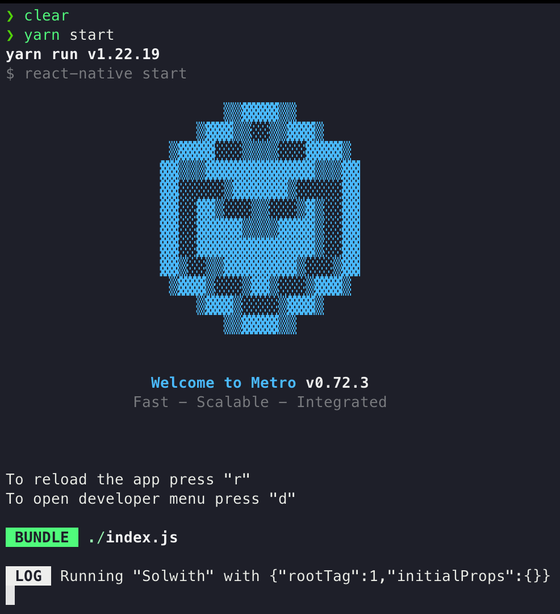

##### IOS 실행 화면

> ``` yarn ios ``` 를 실행하면 나오는 화면입니다. 버그없이 출력된다면 해당 화면으로 나옵니다.

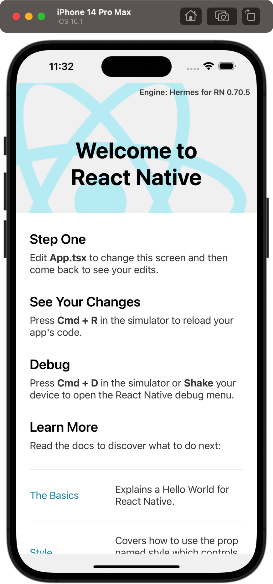


##### Android 실행화면
> yarn android 를 실행하면 나오는 화면

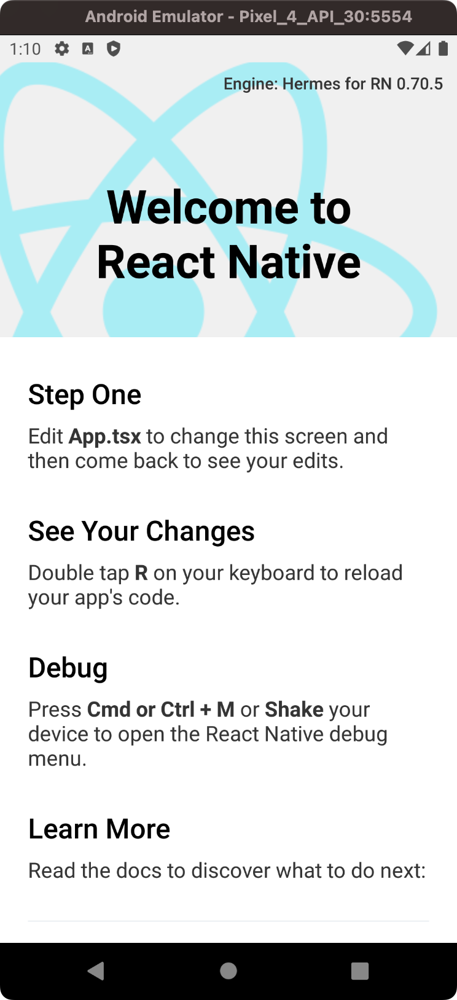


## 삽질 일대기로 깨달은 것

##### yarn Berry 적용 실패와 그 원인 유추

일단 워낙 node 진영에서 가장 문제가 되는 node_modules 
특히 저처럼 컴퓨터가 더러워지는걸 싫어하는 사람들은 더욱 싫어할 수 밖에.. 없을 것 같아요.

최근에 블랙홀보다 무겁다는 node_modules을 해결하기 위한 방안으로 yarn berry가 뜨고있죠!
yarn berry의 개념이나 정의 같은건.. 다음에 다른 글에서 다루기로하고.. 이 글의 중심인 RN에서의 마이그레이션이 문제인데, 저도 고군분투하여 적용하는덴, 성공했으나, 실행이 안되더라고 😔 

RN측에서는 워낙 네이티브 모듈에 접근하는 일이 많다보니 node_modules를 활용하는 경우가 많다고하더라고요. 물론 node_modules 을 그대로 두고 yarn berry를 적용시키는 방법도있지만, 그럼 의미가.. 없지않나요?! 

**그래서 다시 yarn으로 회귀하였답니다..*


##### Multiple Podfiles were found이 발생하는 이유

cocoapods에서 Multiple Podfiles were found이 발생하는 원인은.. 처음 xcode를 설치할 때 다양한 디바이스를 설치한 경우 나타나는데요.

xcodebuild 명령을 통해 삭제할 수 있으나, 저는 다른 디바이스들을 사용해야하는 입장이라.. 여기서 삭제법을 다루지는 않겠습니다.

해당 warring을 없새는 키워드는 <code>xcodebuild</code> 입니다.

### 중요!
xcode가 무한로딩하는 경우가 있습니다.
이 경우는 무조건 icloud의 sync를 풀어주십시오. 혹은 root(sync되지 않는 디렉토리)에 생성하는걸 추천드립니다.

## 결론

오늘은 m1 pro 아키텍처에서 RN을 설치하는 방법에 대해 m1 스럽게 다뤄봤는데요.

아무래도 homebrew로 대부분을 설치하는게 패키지 관리 측면에서 편하고, m1에 더 적합한 환경이지 않을까 싶어서 brew 위주로 환경 구성을 했습니다.

역시 RN은 크로스 플랫폼이다보니.. 버그가 참...

환경구성만 한세월했네요;

아직 많이 부족한 초보 개발자이기에 틀린 부분이 있다면 언제든지 댓글 달아주세요!
