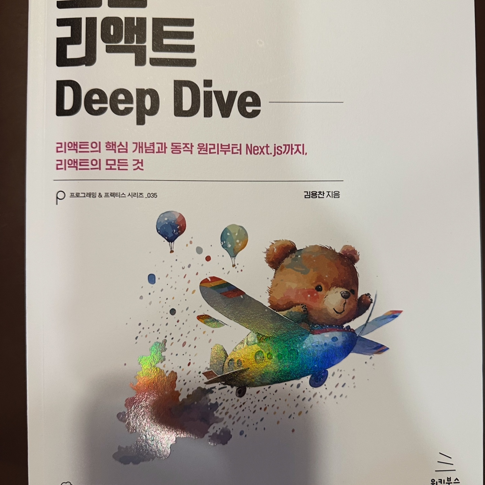
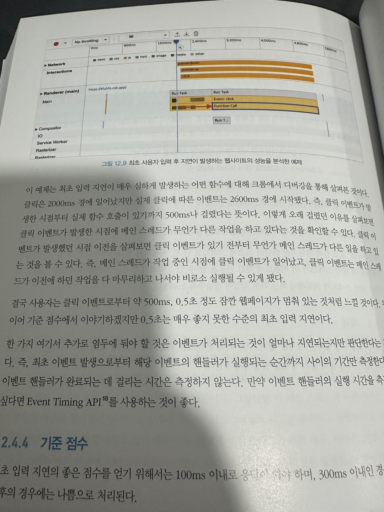

> 예전에 [velog](https://velog.io/@devmingeon/%EC%A3%BC%EB%8B%88%EC%96%B4-%EA%B0%9C%EB%B0%9C%EC%9E%90%EA%B0%80-%EC%9D%BD%EC%96%B4%EB%B3%B8-%EB%AA%A8%EB%8D%98-%EB%A6%AC%EC%95%A1%ED%8A%B8-Deep-Drive)에 올렸던 글을 옮겨 왔습니다.

안녕하세요. 곧 대학원생 전직 예정인 주니어 개발자(?)입니다.

대학원 진학 전 좋은 기회가 생겨서 잠깐 FE 프로그래머로 일할 기회가 생겼는데요..

대학교 생활 중에 React Native 관련 외주 개발자로 2년간 근무했지만 협업이나 웹 성능 측정, React, NextJS 등 모르는게 아직 많아서 고민하던 차에 감사하게도 모던 리액트 Deep Drive 서포터즈로 선정되어서 책도 읽어보고 블로그에서 다루게 되었습니다.

## 모던 리액트 Deep Dive 소개
모던 리액트 Deep Dive는 yceffort라는 블로그를 운영하시는 글쓴이 분이 작성해주신 책입니다. 무려 900페이지 가까운 분량의 무기(?)로 사용해도 될 정도의 책이죠..

괴랄한 분량 만큼 담고 있는 내용의 범위가 큰 책입니다.

읽다보면 글쓰신 분이 최대한 많고, 다양한 분야를 한 책에 엮어서 설명하고자하는 노력이 보이는 책입니다.

개인적으로 생각하기에 읽기 적합한 독자층 아래와 같습니다.
- JavaScript로 코드를 작성하는데 문제가 없고, React를 이용해서 최소 토이프로젝트 정도는할 수 있는 수준

생각보다 책 수준이 높습니다. 다루고있는 분야도 꽤 최신화된 정보를 다루고있고, 내용 자체도 난이도가 있어요.

일례로 책에서 다루는 useEffect 내부 구현 부분을 보면 글쓴이의 깊이가 보이는 부분이랄까요.. 이해하는데 어려움이 있지는 않으나 러닝커브가 조금 있는 책이라고 생각합니다.

(물론 두께가 제일 큰 진입 장벽입니다.)

## 개인적인 후기

개인적으로 내부구조나 구현을 다루는 책을 좋아합니다.

물론 React 같은 오프소스는 공식 Github에 가면 오픈되어있지만, 현실적으로 FE 쪽 분야에 종사하고자 하는 사람이 아니면 시간을 투자하기 쉽지않아요. 이 책은 그런 점에서 좋은 길잡이가 되어주는 것 같습니다. 모든 책의 이점은 지식의 간접경험이라는 점에서 좋은 책이죠.

또 NextJS나 React의 최신 문법을 다루는 부분이나 웹 성능 평가 지표를 다루는 점은 흥미롭고 좋은 책입니다.

물론 단점이 없는 책은 아닌데.. 아무래도 난이도가 좀 있고 웹 성능 지표같은 파트는 비문학 국어 지문 읽는 것 같은 그런 괴로움(?)이랄까.. 그래도 나름 짜임세 있고 읽어볼만한 책이라고 생각합니다.

총평하자면,
"처음 React를 개발해보는 사람이 읽기에는 난이도가 있습니다. 하지만 개발만 해보는 단계를 넘어 테스트나 최적화를 신경쓰는 단계에 오게된다면 읽어보기 좋을 것 같아요."
