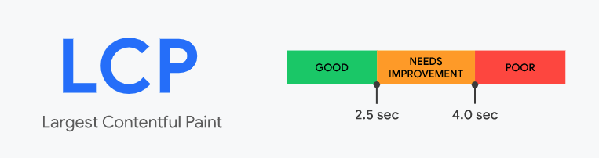
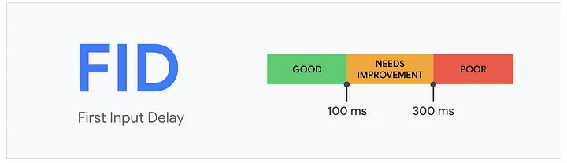
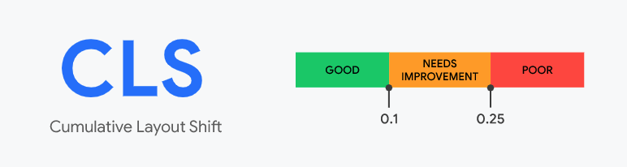
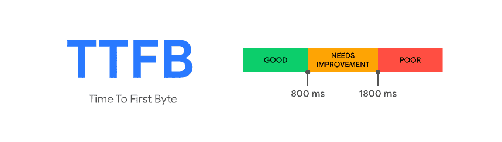
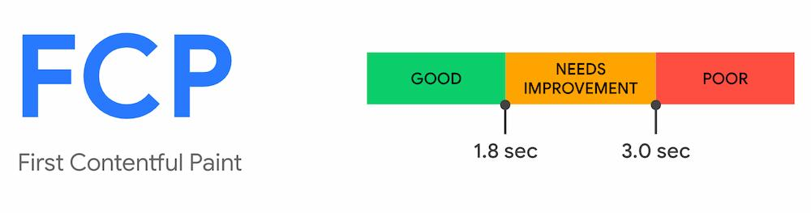
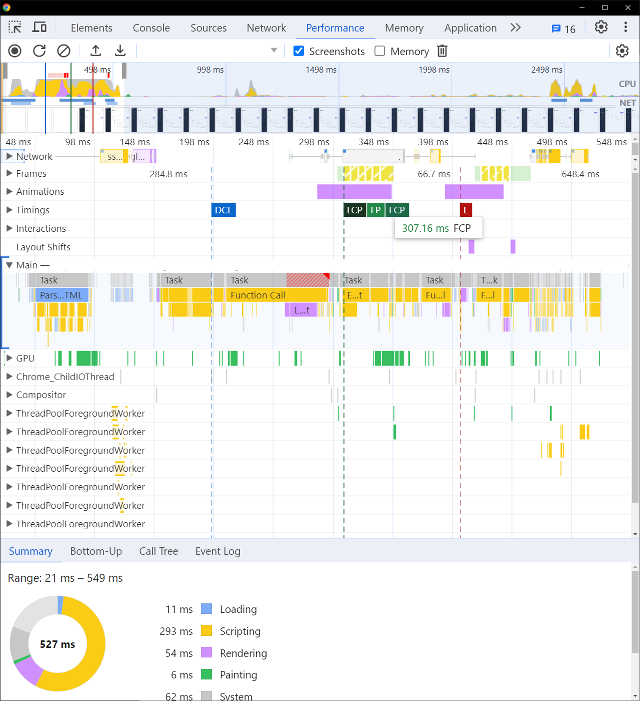
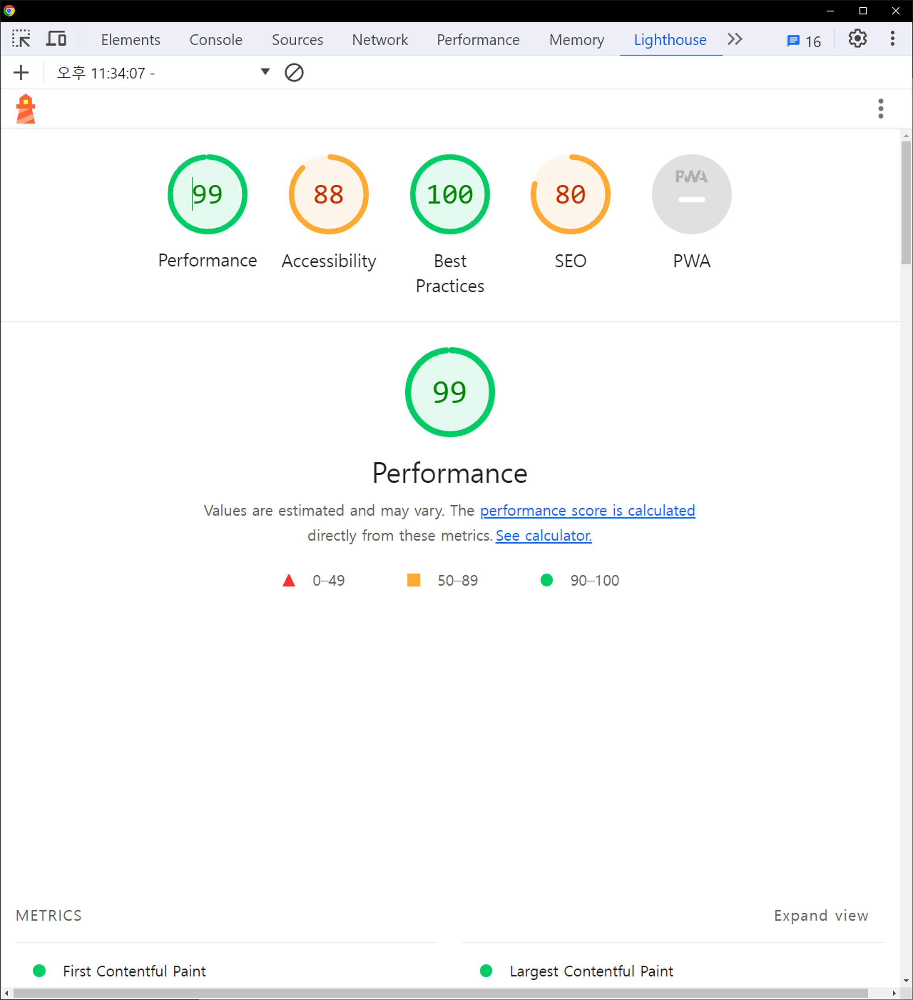

> 예전에 [velog](https://velog.io/@devmingeon/%EB%AA%A8%EB%8D%98-%EB%A6%AC%EC%95%A1%ED%8A%B8-Deep-Dive-%EB%AA%A8%EB%93%A0-%EC%9B%B9-%EA%B0%9C%EB%B0%9C%EC%9E%90%EA%B0%80-%EA%B4%80%EC%8B%AC%EC%9D%84-%EA%B0%80%EC%A0%B8%EC%95%BC%ED%95%A0-%EC%9B%B9-%ED%8E%98%EC%9D%B4%EC%A7%80-%EC%84%B1%EB%8A%A5-%EC%A7%80%ED%91%9C%EC%99%80-%EB%8B%A4%EC%96%91%ED%95%9C-%EC%B8%A1%EC%A0%95)에 올렸던 글을 옮겨 왔습니다.

## 👋 OverView

오늘 포스트에서는 **모던 리액트 Deep Dive** 의 12장, 13장인 웹 페이지 성능 지표와 다양한 측정 방법을 다루는 파트에 대한 리뷰를 다룰려고합니다.

책에서 다양한 실습 파트가 있지만, 웹 성능 지표와 측정 방법 Chapter는 실제 구글에서 제시하는 다양한 웹 성능 지표와 크롬에서 제공하는 DevTools에서 자주 사용해보지 못했던 Performance와 Lighthouse를 실습해 봤습니다. 😀 

실제 개발했던 Admin에 대한 성능 측정이기에 관련 내용을 특정할 수 있는 부분들은 이미지 수정해서 넣었어요 !

해당 사이트의 스펙은 Next.js(SSR 적용) + React + TypeScript 입니다.

## ✏️ 핵심 웹 성능 지표의 종류

### 🚩 LCP (Largest Contentful Paint)

👉 **최대 콘텐츠 풀 페인트 (LCP)**

👍 **페이지가 처음 로드를 시작한 시점부터 뷰포트 내부에서 가장 큰 이미지 또는 텍스트를 랜더링하는데 걸리는 시간**

### 🚩 FID (First Input Delay)

👉 **최초 입력 지연 (FID)**

👍 **사용자가 페이지와 처음 상호 작용할 때부터 해당 상호 작용에 대한 응답으로 브라우저가 실제로 이벤트 핸들러 처리를 시작하기까지의 시간을 측정한 것**

### 🚩 CLS (Cumulative Layout Shift)

👉 **누적 레이아웃 이동 (CLS)**

👍 **페이지 생명주기 동안 발생하는 모든 예기치 않은 이동에 대한 지표**

## 🎯 특정 문제 진단에 활용되는 웹 성능 지표

### 🚩 TTFB (Time To First Byte)

👉 **최초 바이트까지의 시간 (TTFB)**

👍 **브라우저가 웹 페이지의 첫 번째 바이트를 수신하는데까지 걸리는 시간**

### 🚩 FCP (First Contentful Paint)

👉 **최초 콘텐츠풀 페인지 (FCP)**

👍 **페이지가 로드되기 시작한 시점부터 페이지 콘텐츠의 일부가 화면에 랜더링될 때까지의 시간을 측정한 것**

## 📈 Performance 실습

Performance는 브라우저에서 웹사이트의 성능을 프로파일링하고 분석하는데 사용하는 도구입니다!
위에서 배운 요소들을 생각해서 제가 개발한 Admin 사이트를 분석해보겠습니다.

👉 LCP : 307ms로 비교적 빠르게 로딩되는걸 볼 수 있습니다 😀
👉 FCP : FCP도 307ms로 LCP와 같은 성능이네요 !
👉 그런데, 아래 Summary를 살펴보면 Scripting이 꽤 많은 시간을 차지하고 있네요.. 이 부분은 스크립팅 최적화를 고려해봐야 할 듯합니다. 또 리팩토링할 기회가 된다면 다시 최적화를 해보는 것도 좋겠네요 ! 😅

## 🏆 Lighthouse 성능 측정

Lighthouse는 웹 애플리케이션의 성능을 측정하고 개선하는 데 도움을 주는 오픈 소스 도구입니다. 현재는 크롬 devTools에서 제공하고있지요!

👉 Performance : 99! 생각보다 로딩 속도가 매우 빠르게 잘 최적화 되었나봅니다! 기대 이상이네요 😀.
👉 Accessibility : 88. 이 지표는 접근성인데요. 아마 admin 페이지라 mobile 같은 특수한 환경을 고려하지 않고 무조건 Full-Screen으로 개발해서 그런 것 같네요.
👉 Best Practices : 현대 웹 개발 최적화 기준을 잘 따르는지 확인하는 지표인데요. Next.js 13으로 개발되어서 그런가 만점이네요 😄
👉 SEO (Search Engine Optimization) : 80점으로 여기서는 제일 낮네요. 사실 admin 페이지는 검색될 필요 자체가 없기때문에. 신경쓰지 못했나봅니다 ㅠ

## 👏 후기

오늘은 모던 리액트 Deep Dive를 읽고 13장 14장의 웹 성능 지표와 관련된 실습과 개념을 제가 실제로 개발한 Admin 페이지에 적용해봤는데요! 

리팩토링때 고생한 보람있었다는 생각이 들고 기분이 좋네요. 그런데 좀 더 빨리 알았으면 리팩토링 전 후를 비교할 수 있었을텐데 이런 부분은 좀 아쉽네요 ㅠ 

모던 리액트 Deep Dive에는 개념외에도 실제 문제를 해결하기 위한 최적화 기법도 다루고 있으니 읽어보시고 싶으면 아래의 링크로 들어가서 구매해보시길 추천드릴게요! 

#### 📚 [도서 구매 링크](https://www.yes24.com/Product/Goods/123161563)

_~~본 포스팅은 모던 리액트 Deep Dive 서포터즈의 일환으로 작성되었습니다.~~_
