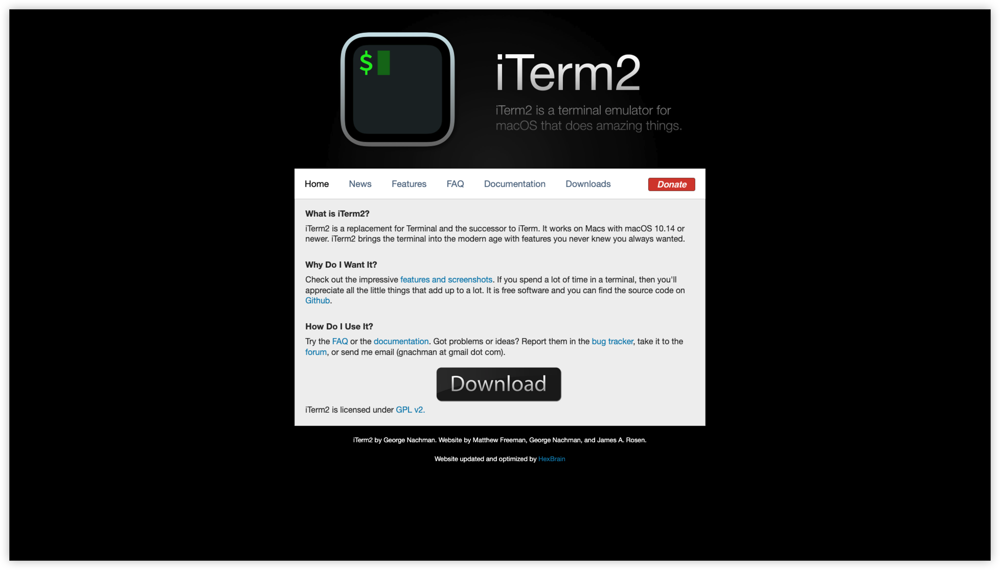
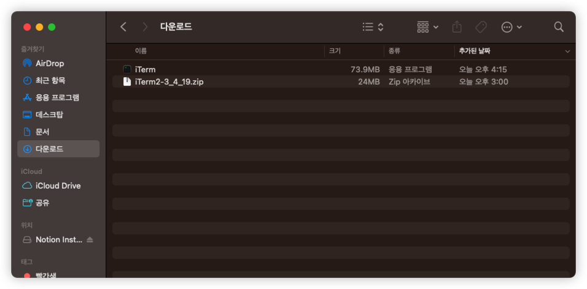
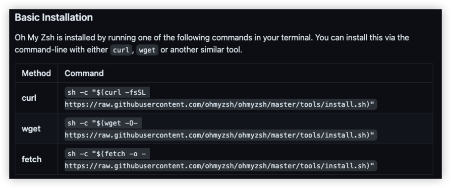
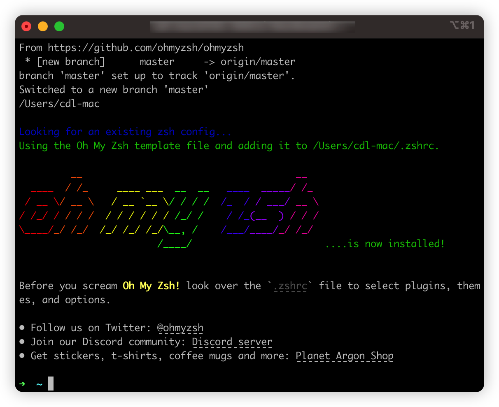
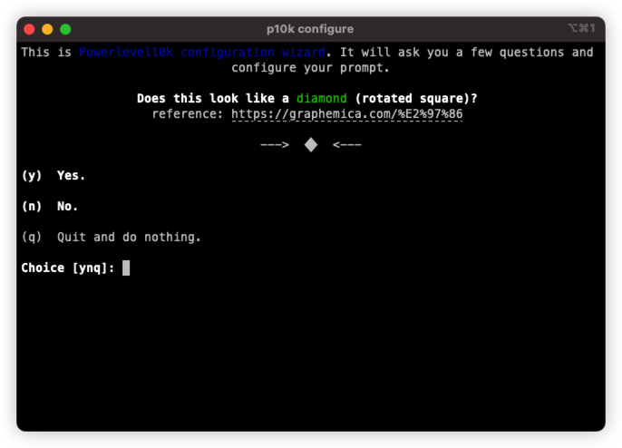
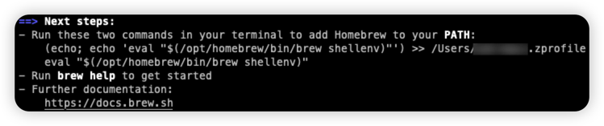

> 예전에 [velog](https://velog.io/@devmingeon/React-Native-%EA%B0%9C%EB%B0%9C%EC%9E%90%EB%A5%BC-%EC%9C%84%ED%95%9C-MacBook-%EC%B4%88%EA%B8%B0-%EC%84%A4%EC%A0%95-%EA%B0%80%EC%9D%B4%EB%93%9C)에 올렸던 글을 옮겨 왔습니다.

## Iterm2

> https://iterm2.com/



다운로드를 눌러서 설치합니다.



압축을 풀고, Iterm.app을 응용프로그램으로 드래그하면 설치완료.

## Oh-My-Zsh

> https://github.com/ohmyzsh/ohmyzsh



아래 내용 중 하나를 선택하여 설치하면됩니다. 맥의 경우 curl을 이용하면 편리합니다.
### curl

```zsh
sh -c "$(curl -fsSL https://raw.githubusercontent.com/ohmyzsh/ohmyzsh/master/tools/install.sh)"
```

### result



그 후 cmd + q로 완전 종료하고 다시 실행해주시는걸 추천드립니다.

## p10k theme
다양한 템플릿이 있지만 저는 p10k를 선호합니다. 아래와 같이 설정합니다.

> https://github.com/romkatv/powerlevel10k#oh-my-zsh

```zsh
git clone --depth=1 https://github.com/romkatv/powerlevel10k.git ${ZSH_CUSTOM:-$HOME/.oh-my-zsh/custom}/themes/powerlevel10k
```

```zsh
vim ~/.zshrc
```
zsrhc에 진입하여 zsh_theme에서 dd(라인삭제)
i(edit)이후 아래의 내용을 붙여넣은 후 esc+wq로 종료

```zsh
ZSH_THEME="powerlevel10k/powerlevel10k"
```

참고로 맨 아래의 해당 내용을 추가하면 추후 zsh 변경에 도움이됩니다.

```zsh
alias zshconfig="vim ~/.zshrc"
alias zshupdate="source ~/.zshrc"
```
아직은 설정되지 않았기에 아래와 같이 진행하면됩니다.
```zsh
source ~/.zshrc
```


실행 후 설치가 완료되면 cmd+q로 종료하고 재 실행합니다.

아래와 같이 나왔다면 성공입니다. 이제 설치 메뉴얼에 따라 진행하세요.




## Homebrew

맥의 대표적인 패키지 매니저를 설치합니다.

> https://brew.sh/index_ko


```zsh
/bin/bash -c "$(curl -fsSL https://raw.githubusercontent.com/Homebrew/install/HEAD/install.sh)"
```



그 후 아래 스탭대로 진행합니다.

### zsh-autosuggestions
> brew install zsh-autosuggestions
> 
> git clone https://github.com/zsh-users/zsh-autosuggestions ${ZSH_CUSTOM:-~/.oh-my-zsh/custom}/plugins/zsh-autosuggestions


### zsh-syntax-highlighting
> brew install zsh-fast-syntax-highlighting


## finally
> 추후 필요한 내용이 있을 시 편집합니다.
